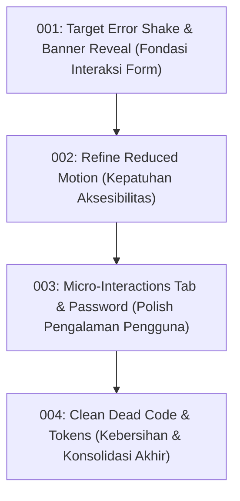

# Implementation Plans — Animation Improvements (Login Page)

Dokumen rencana perbaikan animasi ini disusun berdasarkan metodologi **Emil Kowalski Design Engineering (`improve-animations`)** untuk menyempurnakan interaksi pada antarmuka Login.

## Ringkasan Rencana

| Plan | Judul | Severity | Category | Status |
|---|---|---|---|---|
| [001](001-target-shake-and-error-banner.md) | Target Error Shake to Form and Smooth Banner Reveal | **MEDIUM** | Physicality / Missed Opportunity | DONE |
| [002](002-refined-reduced-motion.md) | Refine Reduced Motion to Preserve Essential Feedback | **MEDIUM** | Accessibility | DONE |
| [003](003-role-icon-and-toggle-micro-interactions.md) | Role Tab Icon Crossfade and Password Toggle Micro-Interactions | **LOW** | Missed Opportunity / Polish | TODO |
| [004](004-dead-code-and-token-cleanup.md) | Clean Dead Code and Consolidate Motion Tokens | **LOW** | Performance / Cohesion | TODO |

---

## Urutan Eksekusi yang Direkomendasikan

### Alasan Prioritas:
1. **001 (Utama)**: Memperbaiki pengalaman pengguna langsung saat terjadi kesalahan input, mencegah getaran seluruh kartu 960px dan menghilangkan lonjakan layout (*layout pop*).
2. **002 (Kedua)**: Menjaga standar aksesibilitas agar pengguna dengan preferensi *reduced-motion* tetap mendapatkan umpan balik visual esensial.
3. **003 (Ketiga)**: Menambah kenikmatan visual mikro saat berganti peran dan saat mengintip kata sandi.
4. **004 (Keempat)**: Merapikan stylesheet dari kode usang dan menyelaraskan token desain.
